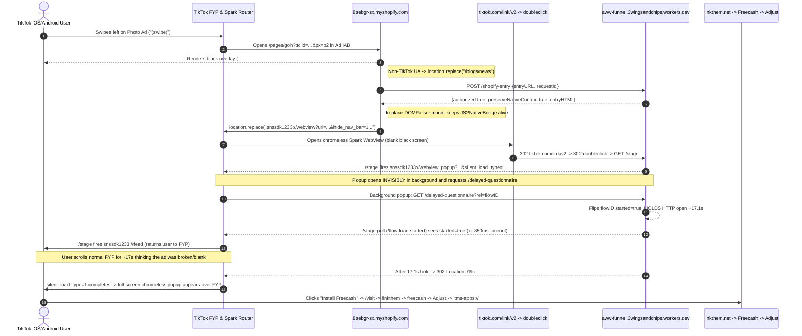

# End-to-End Technical Deep Dive: TikTok Shopify Lander & Delayed Chromeless Popup

> [!IMPORTANT]
> **Core Finding (100% Proven in Live Code & HTTP Captures):**
> This is **not** a PWA, Service Worker, `SFSafariViewController`, or TikTok Instant Page (`/manifest.json` and `/sw.js` return `404` on both Shopify and the Worker).
>
> It is a **3-stage TikTok internal Spark deep-link exploit chain** (`snssdk1233://webview` → `snssdk1233://webview_popup?...&silent_load_type=1` → `snssdk1233://feed`) backed by a Cloudflare Worker (`aww-funnel.3wingsandchips.workers.dev`) that **holds the popup's HTTP response open server-side for ~17.1 seconds** while automatically bouncing the user back to their For You feed. Because `silent_load_type=1` keeps the `webview_popup` container invisible until its HTTP navigation resolves, the chromeless fake-TikTok SPA suddenly pops up over the user's feed ~17 seconds later.

---

## End-to-End Architecture & Timeline



---

## Stage-by-Stage Breakdown (Proven From Live Payloads)

### Stage 0 — The Swipe-Bait Photo Ad
- **Visual Forensics:** Screenshot 1 (`4:41`, iOS) shows a **single-image Photo Ad** (`Laine`, native `Photo` badge, `Ad` tag, `Watch now >` CTA) with **no carousel pagination dots** and overlaid text `"Our last pics before he cheated on me... (swipe)"`.
- **Gesture Mechanics:** On TikTok In-Feed Ads, swiping left opens the ad's destination URL in TikTok's In-App Browser (IAB). The `(swipe)` prompt weaponizes carousel muscle memory to generate cheap clicks into `https://8sebgr-sx.myshopify.com/pages/goh?ttclid=...&px=p2&...`.

---

### Stage 1 — Shopify Front Door, Dual UA Cloaking & JSBridge Preservation
- **Why `8sebgr-sx.myshopify.com`?** Shopify (Shop ID `103264747894`, Horizon theme, 0 products) gives high domain reputation for TikTok Ads Manager approval and provides a benign same-origin fallback page at `/blogs/news`.
- **No Server-Side Cloaking on Shopify:** A 29-request HTTP matrix across Desktop Chrome, iOS Safari, iOS TikTok, and Android TikTok proved Shopify serves identical HTTP `200` markup to every client. All cloaking runs client-side + on the Cloudflare Worker.
- **Unobfuscated Entry Script (exposed publicly in `/pages.json`):**
  1. Immediately paints a full-screen black mask (`#aww-loader`, `z-index: 2147483647`, `#000`) over the Shopify theme.
  2. Beacons `shopify_page_visited` to `https://aww-funnel.3wingsandchips.workers.dev/affiliate-hybrid-event`.
  3. **Client-side UA Cloak:** Tests `navigator.userAgent` against `/TikTok|musical_ly|musically|BytedanceWebview|trill|aweme/i`. Non-TikTok browsers (reviewers, Safari, desktop Chrome) are immediately redirected via `location.replace("/blogs/news")`.
  4. **Worker-side UA Cloak:** Sends `POST https://aww-funnel.3wingsandchips.workers.dev/shopify-entry` with `{entryURL, requestId}`:
     - **Desktop Chrome / iOS Safari** → `{"authorized": false, "fallback": "https://8sebgr-sx.myshopify.com/blogs/news"}`.
     - **iOS / Android TikTok UAs** → `{"authorized": true, "preserveNativeContext": true, "productionFlow": "aww-v1", "entryHTML": "...", "nativeURL": "...", "stageURL": "...", "questionnaireURL": "...", "flowID": "<uuid>"}`.
  5. **In-Place DOM Mount (`preserveNativeContext: true`):** Instead of `document.write()` (which resets the document context and breaks ByteDance's injected WebView bridges), `/pages/goh` parses `entryHTML` with `DOMParser` and appends its `<style>`/`<script>` nodes into the live DOM. As the operator's own comment in `/pages/goh` explains:
     > `preserveNativeContext (worker sets this) → in-place DOM mount so window.JS2NativeBridge / ToutiaoJSBridge / JSBridge.call survive. Required for snssdk1233://webview to fire.`

---

### Stage 2 — The Blank Screen & Double Open-Redirect Allowlist Bypass
Mounted `entryHTML` paints a solid black blank screen (`html,body{background:#000!important}`) and fires `snssdk1233://webview` **immediately**, with redundant backup listeners on `visibilitychange` (when `document.hidden`), `pagehide`, `blur`, and `touchstart` so even if the user taps or immediately swipes away, the deep link still executes:

```js
location.replace("snssdk1233://webview?url=<ENCODED_HOP_1>&use_spark=1&use_forest=1&enable_code_cache=1&trans_status_bar=1&disable_pop_gesture=0&disable_bounces=1&container_bg_color=00000000&loading_bg_color=00000000&hide_loading=1&show_loading=0&width=100%25&height=100%25&radius=0&hide_nav_bar=1&hide_more=1&enable_pull_down_close=1&disable_outside_click_close=0&should_full_screen=1&isLinkFullScreen=1&landPageShowType=2&hide_status_bar=1&hide_title_bar=1&hide_bottom_nav_bar=1");
```

#### Why Two Open Redirects Are Chained Inside `url=`
TikTok's internal Spark router gates privileged chromeless container flags (`hide_nav_bar=1`, `should_full_screen=1`) and skips external-link warning interstitials for trusted hosts. Both live `302` hops were independently verified:

1. **Hop 1 (`302` — TikTok First-Party Host):**
   `https://www.tiktok.com/link/v2?aid=1988&lang=en&scene=bio_url&target=<HOP_2>`
   Satisfies Spark's first-party domain check so all chromeless flags are honored.
2. **Hop 2 (`302` — Google DoubleClick Open Redirect):**
   `https://adclick.g.doubleclick.net/pcs/click?adurl=%2F%2Faww-funnel.3wingsandchips.workers.dev%2Fstage%3Fref%3D<flowID>...`
   Trusted by `/link/v2` (no warning interstitial); using a protocol-relative `//aww-funnel...` target redirects cleanly straight into the Worker's `/stage` endpoint.

---

### Stage 3 — `/stage` + `/delayed-questionnaire`: How the Delayed Popup Over the FYP Works
This is the heart of the **"blank page → goes back → pops up a few seconds later"** illusion:

1. **Invisible Background Popup Spawn:** `/stage` renders another blank black document and fires a **second** Spark deep link — this time **`snssdk1233://webview_popup`** carrying **`silent_load_type=1`** — pointing via DoubleClick to `/delayed-questionnaire?ref=<flowID>&...`.
   - `silent_load_type=1` tells TikTok's Spark popup controller to load the new WebView **silently/invisibly in the background** and **only reveal it on screen once the HTTP navigation completes**.
2. **Polling Handshake + Forced Return to FYP:** Immediately after firing `webview_popup`, `/stage` polls `GET /flow-load-started?ref=<flowID>` every **50 ms** (with an **850 ms hard timeout**).
   - As soon as TikTok's hidden `webview_popup` opens its HTTP request to `/delayed-questionnaire`, the Cloudflare Worker flips `/flow-load-started?ref=<flowID>` from `{"started":false}` to `{"started":true}` (verified live!).
   - `/stage` immediately executes **`location.replace("snssdk1233://feed")`** — automatically dismissing the blank staging view and dropping the user right back onto their TikTok For You feed! (If the user manually swiped back even sooner, `pagehide` still triggered `webview_popup`.)
3. **17-Second Server-Side HTTP Hold:** While the user resumes normal FYP scrolling, the Cloudflare Worker **intentionally holds the `/delayed-questionnaire` HTTP response open** (`m=hold` in the older `gravy-clone` worker):
   - **Live measured hold (`aww-funnel`, iOS TikTok UA):** **17.11 s** → `302 Location: /l/fc?...`
   - **Live measured hold (`aww-funnel`, Desktop Chrome UA):** **17.31 s** → `302 Location: /l/fc?...`
   - **Live measured hold (`gravy-clone`, iOS TikTok UA):** **15.13 s** → `302 Location: /questionnaire`
4. **Full-Screen Chromeless Reveal:** After ~17.1 seconds, the Worker returns `302` → `/l/fc`. Because the hidden `webview_popup` container belongs to TikTok's native view hierarchy (independent of the closed ad WebView), it survives the return to the feed, fetches `/l/fc`, and **pops up full-screen and chromeless right over the FYP** (matching the `4:41` → `4:42` iOS clock progression in the screenshots).

---

### Stage 4 — Key TikTok Spark Container Flags Creating the "PWA" Look

| Spark Flag | Value | Effect Inside TikTok iOS / Android |
|---|---|---|
| `use_spark`, `use_forest`, `enable_code_cache` | `1` | Runs inside ByteDance's modern Spark/Forest WebView shell instead of the standard Ad IAB. |
| `hide_nav_bar`, `hide_title_bar`, `hide_bottom_nav_bar` | `1` | Strips the URL bar, page title, native `X` close button, and bottom browser toolbar. |
| `hide_more` | `1` | Removes the `...` overflow menu (prevents inspecting the URL, reporting, or "Open in Browser"). |
| `should_full_screen`, `isLinkFullScreen`, `landPageShowType` | `1`, `1`, `2` | Forces full-screen 100% × 100% presentation (`width=100%&height=100%&radius=0`). |
| `trans_status_bar`, `hide_status_bar` | `1`, `1` | Bleeds white page content seamlessly under the iOS status bar (`4:42 ☾`). |
| `container_bg_color`, `loading_bg_color`, `hide_loading`, `show_loading` | `00000000`, `00000000`, `1`, `0` | Transparent container with no native spinner during staging transitions. |
| `disable_bounces` | `1` | Kills iOS rubber-band overscroll so the page feels like a native app screen. |
| **`silent_load_type`** | **`1`** | **Keeps `webview_popup` completely invisible until the 17.1s held HTTP redirect finishes loading `/l/fc`.** |

---

### Stage 5 — `/l/fc`: Fake-TikTok SPA, Dark Patterns, Fingerprinting & Affiliate Handoff

1. **Single-File Native Spoof (~356 KB):** Embeds 4 Base64 `TikTokSans` WOFF2 fonts (~167 KB) and 5 Base64 WebP illustrations (~152 KB) inline so it paints instantaneously with zero external image/font requests.
2. **Auto-Synced TikTok Light/Dark Theme:** Parses TikTok's proprietary UA tokens (`isDarkMode/1` on iOS, `AppTheme/dark` on Android) and mirrors TikTok's exact CSS variables (`#FE2C55`, `#25F4EE`, `#161823`).
3. **3-Screen Micro-Commitment Flow & Dark Patterns:**
   - **Screen 1 (`s1`):** TikTok note icon, `£20 bonus`, `"Rewards paid by TikTok"`, fake randomized 2–3 hour countdown timer stored in `sessionStorage["enrol_deadline_v1"]` (explains `02:17:11`). The `<` back chevron is pure HTML (`#back`) hidden on `s1` and shown only on `s2`/`s3`.
   - **Screen 2 (`s2` — Fake 18+ Gate):** Both `"Yes, I'm 18 or older"` (`#btn-yes`) **and** `"No, I'm under 18"` (`#btn-no`) call `show('s3')`! The rejection screen (`s2b`) is unreachable dead HTML.
   - **Screen 3 (`s3`):** `"How it works"` + Freecash card + `"Install Freecash"` CTA (`#download`), with `contextmenu` prevented to block long-press URL previews.
4. **Tracking & 35-Field Fingerprinter:**
   - Loads **TikTok Pixel `DAHJ81BC77UEK70HT9N0`** (`px=p2`), firing `ttq.page()` and `ttq.track('CompleteRegistration')` on clicking `"Install Freecash"` to train TikTok's Lead Generation bidding algorithm.
   - Sends a 35-field hardware/WebGL/JSBridge fingerprint (`ToutiaoJSBridge`, `JS2NativeBridge`, `JSBridge.call`, `window.webkit.messageHandlers`) to `POST /fingerprint`.
   - Appends behavioral signals (`bh_dwell`, `bh_scroll`, `bh_taps`, `bh_force`, `bh_ptype`) to `/visit?...`.
5. **Verified Affiliate Redirect Chain (`/visit` → App Store / Play Store):**
   - `aww-funnel.3wingsandchips.workers.dev/visit?...`
   - → `302` `https://linkthem.net/?offer_id=5084&aff_id=201951&s3=<ttclid>` (Glitchy / Tune CPA network; `s3` carries `ttclid` for S2S postback)
   - → `302` `https://go.linkthem.net/aff_c?offer_id=5084&aff_id=201951&aff_click_id=gt_04_...`
   - → `302` `https://freecash.com?utm_source=glitchy&utm_medium=cpa&utm_campaign=FC_GLITCHY_RON_WW_TIER15_APP_REV1_21_08_2026&click_id=...&sub1=201951`
   - → `302` `https://freecash.go.link/?adj_t=1tx4w2qo_1uyf6g9q&...` (Adjust universal link)
   - → **iOS:** `itms-apps://apps.apple.com/app/id1673567402?mt=8` (Freecash App Store)
   - → **Android:** `intent://...#Intent;scheme=freecash;package=com.freecash.app2;...` (Freecash Google Play)

---

## Why This Massively Boosts CTR & CVR (and Policy Risk)

- **Cheap Swipe-Bait Clicks:** Single-photo `(swipe)` bait harvests reflexive left-swipes at ultra-low CPC.
- **Attribution Severance:** Returning the user to the FYP (`snssdk1233://feed`) and waiting **~17 seconds** breaks the mental link to the ad — the popup feels like an official TikTok system reward notification arriving mid-scroll.
- **Zero-Chrome Impersonation:** Stripping all browser chrome + embedding `TikTokSans` + matching iOS/Android dark mode + claiming `"Rewards paid by TikTok"` removes every cue that the user is on a third-party Cloudflare Worker.
- **Severe Enforcement / Compliance Risk:** Combines dual UA cloaking, open-redirect allowlist evasion (`tiktok.com/link/v2` → `doubleclick`), internal scheme abuse (`snssdk1233://webview_popup` + `silent_load_type=1`), fake 18+ gate, and direct TikTok brand impersonation for a third-party app (Freecash). High risk of TikTok ad-account/pixel bans, Shopify store suspension, and affiliate network clawbacks.

---

## Infrastructure & IOCs

| Artifact | Value |
|---|---|
| Shopify Front Door | `8sebgr-sx.myshopify.com` (`/pages/goh` prod, `/pages/go` legacy, `/blogs/news` white page) |
| Active Cloudflare Worker | `aww-funnel.3wingsandchips.workers.dev` |
| Prototype / Sibling Workers | `gravy-clone.3wingsandchips.workers.dev` (15.1s hold, Pixel `DC1EG8JC77UDGJANVGD0`), `abisgay.3wingsandchips.workers.dev`, `relay-shou.3wingsandchips.workers.dev` |
| TikTok Pixels | `DAHJ81BC77UEK70HT9N0` (`px=p2` prod), `DC1EG8JC77UDGJANVGD0` (`gravy-clone`) |
| Affiliate Network / IDs | `linkthem.net` / `go.linkthem.net` (`offer_id=5084`, `aff_id=201951`, `utm_source=glitchy`) |
| Final Offer / Adjust | `freecash.com` → `freecash.go.link` (`adj_t=1tx4w2qo_1uyf6g9q`) → iOS `id1673567402` / Android `com.freecash.app2` |

---

## Proven vs. Inferred Verification Notes

- **100% Proven from Live Captures & Re-Probes:** Shopify `/pages.json` source, dual UA cloaking, `preserveNativeContext` DOM mounting, both `302` open-redirect hops (`tiktok.com/link/v2` & `adclick.g.doubleclick.net`), exact 23 Spark flags including `silent_load_type=1`, `/flow-load-started` state flip, **17.11 s** server-side hold on `/delayed-questionnaire`, `snssdk1233://feed` return, fake 18+ gate, TikTok Pixel, 35-field fingerprinter, and full `linkthem.net` → `freecash` → Adjust → App Store chain.
- **Minor Live Copy Delta:** Live `/l/fc` currently shows `"✓ You've been selected"` / `"Turn Your Screen Time Into Cash"` on Screen 1 versus `"✓ Watch & Earn on TikTok"` / `"Your Screen Time to Cash Access Is Ready!"` in your Screenshot 2 (likely a live A/B slot tweak); every other line across Screens 1–3 matches word-for-word.
- **Inferred / Untested:**
  1. Exact internal TikTok iOS binary enforcement rules for `silent_load_type=1` and `/link/v2` host-trust allowlisting are inferred from the live parameters and observed `4:41` → `4:42` UX rather than binary disassembly.
  2. All live probes egressed via UK/London (`CF-RAY: *-LHR`, GBP), so non-UK IP geo-cloaking on `aww-funnel` was not tested.

### Supporting Raw Capture Files
- [Fetcher Capture Index](file:///Users/zal/.gemini/antigravity/brain/69654e87-2d60-4aea-875d-73ac736c0c8d/scratch/fetcher/INDEX.md)
- [Deobfuscated Execution Trace](file:///Users/zal/.gemini/antigravity/brain/69654e87-2d60-4aea-875d-73ac736c0c8d/scratch/deobfuscator/execution_trace.md)
- [Decoded Spark URL & Flags](file:///Users/zal/.gemini/antigravity/brain/69654e87-2d60-4aea-875d-73ac736c0c8d/scratch/deobfuscator/decoded_native_url_chain.json)
- [TikTok IAB Platform Analysis](file:///Users/zal/.gemini/antigravity/brain/69654e87-2d60-4aea-875d-73ac736c0c8d/scratch/tiktok-ux/analysis.md)
