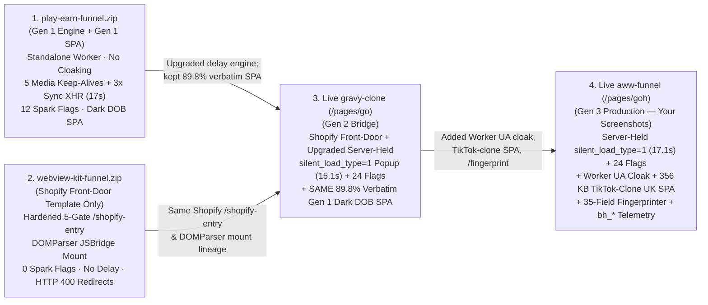

# 4-Way Forensic Comparison: Friend's Zips vs. Live `gravy-clone` & `aww-funnel`

> [!IMPORTANT]
> **Bottom Line:** Both uploaded archives (`webview-kit-funnel.zip` and `play-earn-funnel.zip`) come from the **exact same kit family and codebase lineage** as the live `8sebgr-sx.myshopify.com` / `3wingsandchips.workers.dev` stack — packaged **8 seconds apart** (`2026-11-26 17:45–17:51`) with byte-for-byte identical `wrangler.toml` and matching MaxConv (`mc_adset_name`) + Clarity + Python/Node build tooling.
>
> However, they represent **two split, older/sanitized halves** — **neither archive alone reproduces the live `aww-funnel` stack**, and **`webview-kit-funnel.zip`'s hardcoded open-redirect URLs actually return HTTP `400` live.**

---

## Evolutionary Lineage (Gen 1 → Gen 3)

---

## Smoking-Gun Proofs of Shared Lineage

1. **Literal `/pages/go` & `/pages/goh` Reference in `webview-kit-funnel.zip`:**
   `webview-kit/templates/page-body.html` line 2 literally says:
   > `Paste this as the BODY of a Shopify page (e.g. /pages/go or /pages/goh).`
   It also shares identical routes (`/shopify-entry`, `/stage`, `/affiliate-hybrid-event`), identical JSON keys (`authorized`, `entryHTML`, `nativeURL`, `stageURL`, `flowID`, `preserveNativeContext`, `productionFlow`, plus backwards-compatible `body.entryUrl || body.entryURL`), identical TikTok UA regex (`/TikTok|musical_ly|musically|BytedanceWebview|trill|aweme/i`), and the exact same `DOMParser` in-place JSBridge-preserving script mount loop.
2. **89.8% Verbatim Character Match Between `play-earn-funnel.zip` & Live `gravy-clone`:**
   - `play-earn/templates/lander.html` (43,245 chars) vs. live `gravy-clone/questionnaire` (41,289 chars) has **37,065 verbatim matched characters** in ≥100-char blocks (`SequenceMatcher` ratio `0.8818`) — identical `<style>` IDs (`screentime-dark`, `program-refinements`, `program-continuity`, `reward-phone-hero`, `page-pinch-lock`, `owner-popup-standard-dismiss`), identical pinch-zoom lock, identical 3-step DOB + `#steps-affirmation` state machine, and identical double-rAF `POST /visible` beacon.
   - **Sanitization Artifact Smoking Gun:** `play-earn/templates/lander.html:90` still executes dead calls `window.__fx && window.__fx('CompleteRegistration')` and `window.__fx && window.__fx('Purchase')` — even though `window.__fx` is never defined in `play-earn`! In live `gravy-clone`, `window.__fx` is defined by the TikTok Pixel (`DC1EG8JC77UDGJANVGD0`) snippet that was stripped out when packaging `play-earn`.
3. **Shared Protocol & Redirect DNA Across All Four:**
   - Exact same telemetry route name `/affiliate-hybrid-event`.
   - Exact same `p=17` (17-second) hold target (`play-earn` `17.0s`, live `aww-funnel` `17.11s`).
   - Exact same TikTok UA regex inside the stage page (`/TikTok|musical_ly|Bytedance|trill/i`).
   - `play-earn`'s 12 `POPUP_FLAGS` are a strict subset of `gravy-clone` / `aww-funnel`'s 24 Spark flags.

---

## Complete 4-Way Technical Matrix

| Dimension | `play-earn-funnel.zip` | `webview-kit-funnel.zip` | Live `gravy-clone` (`/pages/go`) | Live `aww-funnel` (`/pages/goh`) |
|---|---|---|---|---|
| **Front Door** | Standalone Worker (`/w?...`); **no Shopify** | Shopify Page (`/pages/go` or `/pages/goh`) → `POST /shopify-entry` | Shopify `/pages/go` → `POST /shopify-entry` | Shopify `/pages/goh` → `POST /shopify-entry` |
| **Cloaking / Gates** | **None** on Worker (only client UA guard before `snssdk1233://feed`) | **Strictest 5-gate front door**: `CRAWLER_UA` blocklist, TikTok UA allowlist, exact `storeOrigin`+`pagePath`, hard client+server `?k=` gate, `sub1` regex, `Shopify.designMode` guard, `text/plain` POST (skips CORS preflight) | Client UA bounce to `/blogs/news`; auto-injects `?k=demo`; Worker allows Desktop Chrome | Client UA bounce + **Server Worker UA cloak** (`authorized:false` → `/blogs/news`); `?k=` soft-logged only |
| **JSBridge Preservation** | Not needed (direct Worker `/w`) | `DOMParser` in-place mount + `document.write` fallback (`preserveNativeContext: true`) | `DOMParser` in-place mount (`preserveNativeContext: true`) | `DOMParser` in-place mount (`preserveNativeContext: true`) |
| **Stage 1 Deep Link** | `snssdk1233://webview_popup` (**7 flags**, `disable_pop_gesture=1`, `silent_load_type=1`) | `snssdk1233://webview?url=...` (**0 Spark flags**, immediate + 120ms retry, no exit hooks) | `snssdk1233://webview` (**23 Spark flags**, `disable_pop_gesture=0`, 4 exit/touch listeners) | `snssdk1233://webview` (**23 Spark flags**, `disable_pop_gesture=0`, 4 exit/touch listeners) |
| **Open-Redirect Chain** | `tiktok.com/link/v2?aid=1988&lang=en&scene=bio_url&target=` → `adclick.g.doubleclick.net/pcs/click?adurl=//...` (**Live `302`**) | `tiktok.com/link/v2?target=` → `ad.doubleclick.net/ddm/clk/pagead/aclk?adurl=https://...` (**BOTH FAIL LIVE WITH HTTP `400`!**) | Same working `link/v2?aid=1988...` → `adclick.g.doubleclick.net/pcs/click?adurl=//...` (**Live `302`**) | Same working `link/v2?aid=1988...` → `adclick.g.doubleclick.net/pcs/click?adurl=//...` (**Live `302`**) |
| **Delay & Feed-Return Engine** | **Gen 1 Client-Driven (Fragile):** `/e` fires **5 background keep-alives** (silent WAV `<audio>`, muted 1×1 MP4 `<video>`, 1Hz `AudioContext`, `mediaSession='playing'`, `ToutiaoJSBridge`/`bytedance://dispatch_message` mute), immediately calls `snssdk1233://feed`, then runs **3 sequential synchronous XHRs** (`/z/h?p=17&c=0..2`, ~5.67s each = 17s) from the backgrounded `/e` WebView before firing `webview_popup` → `/q` | **NONE** (`/stage` serves `lander.html` immediately at `200 OK`; no feed return, no hold, no popup) | **Gen 2 Server-Held Popup:** `/stage` pre-spawns `snssdk1233://webview_popup?...&silent_load_type=1` to `/delayed-questionnaire?m=hold` (**15.13s** single hold), polls `/flow-load-started` (100ms / 1500ms), then fires `snssdk1233://feed` (+ `aweme://` fallbacks) | **Gen 3 Server-Held Popup:** `/stage` pre-spawns `snssdk1233://webview_popup?...&silent_load_type=1` to `/delayed-questionnaire` (**17.11s** single hold), polls `/flow-load-started` (50ms / 850ms), then fires `snssdk1233://feed` |
| **Stage 2 Popup Spark Flags** | **12 flags** (`disable_pop_gesture=1`; omits 12 full-screen/bar-hiding flags) | **None** | **24 flags** (`disable_pop_gesture=0`, adds `landPageShowType=2`, `hide_title_bar=1`, `hide_bottom_nav_bar=1`, `isLinkFullScreen=1`, etc.) | **24 flags** (identical to `gravy-clone`) |
| **Lander SPA & UI Spoofing** | Dark `#111` 3-step DOB + `#steps-affirmation` SPA (43 KB), 1× 66 KB `TikTok Sans Light` WOFF2, TikTok/CashApp/Venmo/Apple SVGs, unconditional `POST /eligibility` (`{eligible:true}`), disabled hidden `×` button, pinch-zoom lock | Generic dark `#0f1115` 2-step SPA (7.8 KB), system font, genuine `#ackCheck` gate, **no TikTok branding** | **89.8% identical** to `play-earn` (`Screentime to Cash Program`, `Playful Rewards`, `$500/day`, unused `.scam` badge CSS) | **356 KB single-file TikTok clone** (`/l/fc`), 4× base64 `TikTokSans` WOFF2 + 5 WebPs, **auto light/dark UA theme sync** (`isDarkMode`/`AppTheme`), fake 2–3h countdown, **fake 18+ Yes/No gate** (both → `s3`), `"Rewards paid by TikTok"` |
| **Analytics & Anti-Bot** | Optional Clarity + `/diagnostic` + `/affiliate-hybrid-event` + `/visible`; dead `window.__fx` calls; **no fingerprinter** | Optional Clarity + optional TikTok Pixel (`InitiateCheckout`, `CompleteRegistration`, `Purchase`); **no fingerprinter** | TikTok Pixel `DC1EG8JC77UDGJANVGD0` (`CompleteRegistration`, `Purchase`); **no fingerprinter** | TikTok Pixel `DAHJ81BC77UEK70HT9N0` (`CompleteRegistration`) + **35-field `/fingerprint`** + **`bh_*` behavioral telemetry** + `contextmenu` block |
| **Offer / Tracker Params** | `/visit` → `OFFER_URL` with **`mc_adset_name`**, `utm_campaign`, `utm_content`, `source`, `sub1`, `s2`, `ttclid`, `sub2`, `sub5` | Direct CTA link to `OFFER_URL` with **`mc_adset_name`**, `utm_campaign`, `utm_content`, `source`, `sub1`, `s2`, `ttclid`, `sub5` | Placeholder `REPLACE-OFFER-URL.example/go` | `/visit` → `linkthem.net` (`offer_id=5084`, `aff_id=201951`, `s3=<ttclid>`) → Glitchy → `freecash.com` → Adjust → App Store / Play Store |

---

## Key Architectural Takeaways (Why Live `aww-funnel` Evolved Past Both Zips)

1. **Why Gen 2/3 Replaced `play-earn`'s Audio/Video Keep-Alive + Sync-XHR Trick:**
   In `play-earn-funnel.zip`, returning to `snssdk1233://feed` *first* forces the dismissed `/e` WebView to stay alive in the background for 17 seconds using 5 fragile audio/video/JSBridge keep-alive hacks and 3 blocking synchronous XHR chunks (`/z/h`). On modern iOS, `WKWebView` aggressively suspends backgrounded tabs. Live `gravy-clone` and `aww-funnel` solved that cleanly by **spawning `snssdk1233://webview_popup?...&silent_load_type=1` BEFORE calling `snssdk1233://feed`**, moving the 17-second wait into a single server-held HTTP connection inside TikTok's own native Spark popup controller.
2. **Critical Live Bug Found in `webview-kit-funnel.zip`:**
   Independent live HTTP probes confirmed that **both** open-redirect URLs hardcoded in `webview-kit/templates/worker.js:41-42` fail with **HTTP `400`** (`Location: None`):
   - `https://www.tiktok.com/link/v2?target=...` (missing `aid=1988&lang=en&scene=bio_url`) → **HTTP 400**
   - `https://ad.doubleclick.net/ddm/clk/pagead/aclk?adurl=https://...` → **HTTP 400**
   Whereas `play-earn`, `gravy-clone`, and `aww-funnel` use `tiktok.com/link/v2?aid=1988&lang=en&scene=bio_url&target=...` and `adclick.g.doubleclick.net/pcs/click?adurl=//...` (both verified live **HTTP 302**).
3. **One Thing `webview-kit` Actually Does Cleaner Than Live `aww-funnel`:**
   Its front-door `/shopify-entry` endpoint enforces 5 stricter gates (`CRAWLER_UA` blocklist, exact `storeOrigin` + `pagePath`, hard client+server `?k=` gate, `sub1` regex), uses `content-type: text/plain` to avoid a CORS `OPTIONS` preflight round-trip, and includes a `Shopify.designMode` guard so the Shopify theme editor doesn't bounce itself.

---

### Supporting Detailed Analysis Files
- [`webview-kit-funnel.zip` Full Dissection](file:///Users/zal/.gemini/antigravity/brain/69654e87-2d60-4aea-875d-73ac736c0c8d/scratch/friend_zips/webview_kit_analysis.md)
- [`play-earn-funnel.zip` Full Dissection](file:///Users/zal/.gemini/antigravity/brain/69654e87-2d60-4aea-875d-73ac736c0c8d/scratch/friend_zips/play_earn_analysis.md)
- [Extracted `webview-kit-funnel` Source Tree](file:///Users/zal/.gemini/antigravity/brain/69654e87-2d60-4aea-875d-73ac736c0c8d/scratch/friend_zips/webview-kit-funnel/webview-kit/templates/worker.js)
- [Extracted `play-earn-funnel` Source Tree](file:///Users/zal/.gemini/antigravity/brain/69654e87-2d60-4aea-875d-73ac736c0c8d/scratch/friend_zips/play-earn-funnel/play-earn/templates/worker.js)
